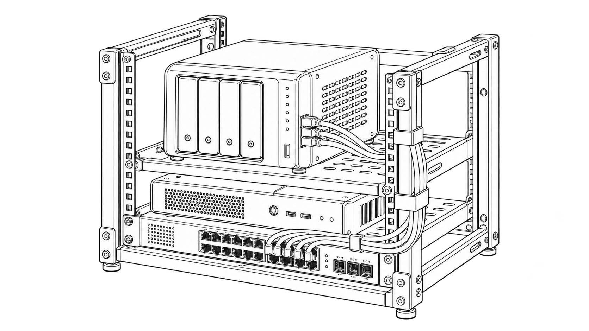

# HomeLab



*Generated line-art concept illustration.*

A small local operations stack: filesystem readings, OS load, bounded SQLite history, a read-only dashboard, Prometheus text, and checked backup/restore. Python 3.12+ is the only application requirement. It needs no account or paid service.

## Run locally

```sh
python3 homelab.py serve --data .local-data
```

Open <http://127.0.0.1:8086>. The service collects a real sample at startup, then every 10 seconds. Stop it with Ctrl+C. Set `--interval 60` for one-minute samples. At most 1,440 samples are retained; this gives approximately 4 hours at 10 seconds or 24 hours at one minute. The dashboard refreshes every 10 seconds.

The disk values describe the filesystem that contains the data directory. Load is the OS-visible one-minute load average, not CPU percentage. Windows reports load as unavailable. Container readings are not guaranteed to describe the whole host. This is not monitoring of other services, network devices, temperature, power, or RAID health.

## Container deployment

Requires an existing Docker Engine/Desktop with Compose v2. Do not install it only to read this repository.

```sh
docker compose up --build --wait
```

The dashboard is mapped to host loopback port8086. The service runs as UID10001 with a read-only container root, a named data volume, no Linux capabilities, and a 128MiB memory limit. It has no Docker socket or host filesystem mounts. The official Python3.13-slim base index is digest-pinned in [Dockerfile](Dockerfile). Image updates require a reviewed digest update and successful checks.

```sh
docker compose stop
# Later, resume with the same retained volume:
docker compose up --wait
```

`docker compose down` removes the containers and network while retaining readings. `docker compose down --volumes` also removes readings; use it only for disposable test data. No remote access, TLS proxy, authentication or public deployment is configured. The process-level `--host 0.0.0.0` option exists for the container; the supplied host port remains loopback-only.

## Back up and prove recovery

For a local run, the service can stay running during backup:

```sh
python3 homelab.py backup --data .local-data --out .local-backup
python3 homelab.py verify --backup .local-backup
python3 homelab.py restore --backup .local-backup --data .local-restored
```

`verify` performs a complete restore into temporary storage, checks the restored history, and reports the verified row count, byte size and SHA-256. It removes its temporary files automatically and leaves the backup and live data unchanged. It needs temporary free space at least as large as the database (up to 64 MiB). Verification checks this local snapshot; separate-device recovery still needs a separate drill.

Both destination directories must be new. Backup uses SQLite's online backup API for a consistent snapshot. Restore checks SHA-256, byte size, database integrity, schema, and all sample values. It never overwrites an existing data directory. Stop the old service, then start it with `--data .local-restored` when you intend to use the recovered history. Keep backup copies on a separate storage device to protect against device failure; no backup transport or encryption is supplied.

For the Compose stack:

```sh
docker compose exec monitor python /app/homelab.py backup --data /data --out /tmp/snapshot
docker compose cp monitor:/tmp/snapshot ./new-backup
```

The temporary snapshot is lost when that container is replaced. Copy it out before replacement. To restore into a new named volume, follow [recovery.md](docs/recovery.md). A checksum checks accidental changes; it does not establish who created a snapshot.

## Checks and evidence

```sh
python3 -m unittest discover -s tests -v
python3 tools/acceptance.py
python3 homelab.py demo --out new-synthetic-demo
```

The tests cover retention, bad input, real collection, consistent snapshots, corrupted/wrong-schema rejection, destination preservation, HTTP health/staleness, fixed routes, Host checks and read-only methods. Acceptance starts a real local process, reads its health/history, and exercises the actual CLI backup/restore. Its temporary data are removed automatically.

[synthetic-recovery.json](examples/synthetic-recovery.json) is explicitly synthetic and reproduced byte-for-byte by acceptance. The live service never substitutes these fixture values. It contains five sample readings and an equal restored history. No claim of months of uptime or a physical rack build follows.

CI runs software/acceptance on Python3.12/3.13 across Linux/macOS/Windows, plus actual Linux Compose start, health, backup/restore and retained-volume restart. Check the current workflow result; local Docker validation is unavailable on the development Mac. [Verification](docs/verification.md) separates local evidence from CI and hardware gaps.

## Interfaces and history

Read [contract](docs/contract.md) and [OpenAPI](docs/openapi.json) for exact routes and bounds. `/metrics` exposes Prometheus text; no separate Prometheus server is bundled. `/api/history` returns a bounded JSON history. The page has no write endpoints or shell controls.

New source is MIT. The original unrelated dashboard remains recoverable on `archive/before-homelab-2026-10-27`; none of its code or artwork is reused. Repository identity and stars are retained. The approved cover is concept art, with [provenance](docs/images/cover-provenance.json). This project was implemented on27October2026; the older repository date is not its build date.
